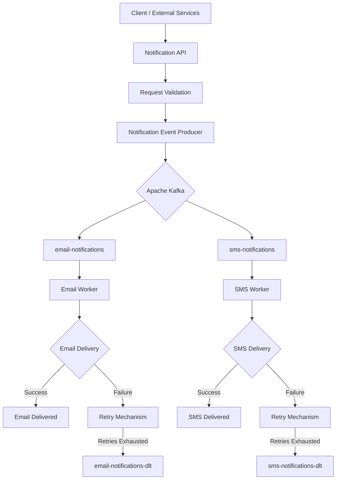

# NotifyFlow 🚀
### Event-Driven Notification Service | Java 21 · Spring Boot · Apache Kafka · Microservices

NotifyFlow is an event-driven notification platform designed to process and distribute email and SMS notifications asynchronously using Spring Boot microservices and Apache Kafka.

The system is designed with reliability, scalability, fault tolerance, and loose coupling in mind. It demonstrates how distributed backend services can communicate through event-driven architecture while handling message failures, retries, duplicate events, and notification delivery lifecycle management.

The long-term goal is to build a production-oriented notification infrastructure similar to the notification systems used in large-scale fintech and distributed applications.

---

## 📌 Table of Contents

- Overview
- Architecture
- Microservices
- Technology Stack
- Kafka Topics & Message Flow
- Reliability & Fault Tolerance
- API Documentation
- Project Structure
- Getting Started
- Future Enhancements
- Engineering Concepts
- Author

---

## 🎯 Project Overview

In distributed applications, multiple services may need to send notifications for different business events, such as:

- Transaction confirmations
- Payment success and failure alerts
- OTP and authentication messages
- Account activity notifications
- Order and service updates

Sending notifications synchronously can increase API response times and introduce dependencies on external notification providers.

NotifyFlow addresses this by introducing an asynchronous event-driven architecture.

Instead of directly sending notifications from the API, the system publishes notification events to Apache Kafka. Dedicated consumer microservices independently process email and SMS events.

This architecture provides:

- Asynchronous notification processing.
- Independent scaling of notification workers.
- Decoupled communication between services.
- Retry handling for transient failures.
- Dead Letter Topics for permanently failed events.
- A foundation for idempotent processing and reliable delivery tracking.

---

## 🏗️ System Architecture



### Architecture Design

NotifyFlow follows an event-driven microservices architecture with three independently deployable application services.

1. The Notification API accepts and validates incoming notification requests.
2. The Kafka producer publishes notification events to the appropriate topic.
3. The Email Worker consumes email events independently.
4. The SMS Worker consumes SMS events independently.
5. Failed events are retried automatically.
6. Events that continue failing after the configured retries are published to Dead Letter Topics.

Kafka acts as the messaging infrastructure connecting the application services.

---

## 🧩 Microservices

### 1. Notification API

**Port:** `8081`

Responsible for accepting notification requests and publishing notification events.

Responsibilities:

- Exposes REST APIs for notification requests.
- Validates notification type, recipient, and message.
- Generates unique event IDs.
- Creates notification events.
- Routes events to the appropriate Kafka topic.
- Returns an HTTP `202 Accepted` response for accepted requests.

### 2. Email Worker

**Port:** `8082`

Responsible for asynchronously processing email notification events.

Responsibilities:

- Consumes events from `email-notifications`.
- Uses an independent Kafka consumer group.
- Processes email notification payloads.
- Simulates successful email delivery locally.
- Simulates failures for testing.
- Implements automatic retries.
- Publishes permanently failed events to `email-notifications-dlt`.

### 3. SMS Worker

**Port:** `8083`

Responsible for asynchronously processing SMS notification events.

Responsibilities:

- Consumes events from `sms-notifications`.
- Uses an independent Kafka consumer group.
- Processes SMS notification payloads.
- Simulates successful SMS delivery locally.
- Simulates failures for testing.
- Implements automatic retries.
- Publishes permanently failed events to `sms-notifications-dlt`.

---

## 📨 Kafka Topics & Message Flow

NotifyFlow uses separate Kafka topics for different notification channels.

| Topic | Purpose |
|---|---|
| `email-notifications` | Incoming email notification events |
| `sms-notifications` | Incoming SMS notification events |
| `email-notifications-dlt` | Permanently failed email events |
| `sms-notifications-dlt` | Permanently failed SMS events |

### Consumer Groups

| Consumer | Consumer Group |
|---|---|
| Email Worker | `email-worker-group` |
| SMS Worker | `sms-worker-group` |

Each notification channel has an independent consumer group, allowing email and SMS processing to scale independently.

### Event Structure

Example notification event:

```json
{
  "eventId": "9df157a9-4ee9-432a-bf59-d4de2a8254a6",
  "type": "EMAIL",
  "recipient": "user@example.com",
  "message": "Your transaction was successful",
  "createdAt": "2026-11-12T10:30:00"
}
```

The event ID acts as a unique identifier for the notification throughout its processing lifecycle.

---

## 🔄 Reliability & Fault Tolerance

Reliable message processing is an important part of NotifyFlow.

### 1. Automatic Retry Mechanism

Spring Kafka's `DefaultErrorHandler` is configured with `FixedBackOff`.

Current configuration:

```java
FixedBackOff backOff = new FixedBackOff(2000L, 3L);
```

This configuration provides:

- One initial processing attempt.
- Three retry attempts.
- Two-second intervals between retries.
- Four total processing attempts before recovery.

### 2. Dead Letter Topics (DLT)

When a notification continues failing after all configured retries, the failed event is published to its corresponding Dead Letter Topic.

For example:

```text
sms-notifications
       |
       v
   SMS Worker
       |
       v
  Processing Failure
       |
       v
    Retry x 3
       |
       v
sms-notifications-dlt
```

This prevents permanently failing events from being retried indefinitely and allows failed notifications to be inspected and handled separately.

### 3. Failure Simulation

The workers support local failure simulation to validate retry and DLT behavior.

Example:

```json
{
  "type": "SMS",
  "recipient": "fail-sms@example.com",
  "message": "Testing retry mechanism"
}
```

The worker intentionally throws an exception, triggering the configured retry mechanism.

Both email and SMS retry and DLT flows have been tested locally.

---

## 🔌 API Documentation

### Submit Notification

**Endpoint**

```http
POST /api/v1/notifications
```

**Base URL**

```text
http://localhost:8081
```

### Example: Email Notification

Request:

```json
{
  "type": "EMAIL",
  "recipient": "user@example.com",
  "message": "Your payment was successful"
}
```

### Example: SMS Notification

Request:

```json
{
  "type": "SMS",
  "recipient": "+919876543210",
  "message": "Your OTP is 123456"
}
```

### Example Response

HTTP Status: `202 Accepted`

```json
{
  "message": "Notification request accepted",
  "type": "SMS",
  "recipient": "+919876543210",
  "status": "ACCEPTED"
}
```

**Note:** `202 Accepted` indicates that the request was accepted by the API. It does not guarantee successful delivery to the recipient.

---

## 🛠️ Technology Stack

| Technology | Usage |
|---|---|
| Java 21 | Primary programming language |
| Spring Boot | Microservice development |
| Spring Web | REST API development |
| Spring Kafka | Kafka producer and consumer integration |
| Apache Kafka 4.1.1 | Event streaming and messaging |
| Maven | Build and dependency management |
| Docker | Containerization |
| Docker Compose | Local infrastructure management |
| JUnit 5 | Unit testing |
| Mockito | Mock-based testing |
| MySQL | Planned notification persistence |

---

## 📂 Project Structure

```text
NotifyFlow/
│
├── notification-api/
│   └── src/main/java/
│       └── com/notifyflow/api/
│           ├── controller/
│           ├── service/
│           ├── producer/
│           ├── event/
│           ├── dto/
│           └── config/
│
├── email-worker/
│   └── src/main/java/
│       └── com/notifyflow/email/
│           ├── consumer/
│           ├── event/
│           └── config/
│
├── sms-worker/
│   └── src/main/java/
│       └── com/notifyflow/sms/
│           ├── consumer/
│           └── event/
│
├── docker-compose.yml
├── .gitignore
└── README.md
```

---

## ⚙️ Getting Started

### Prerequisites

Install the following:

- Java 21
- Maven
- Docker Desktop
- Git

### 1. Clone Repository

```bash
git clone https://github.com/sivasaidwarapureddy/NotifyFlow.git

cd NotifyFlow
```

### 2. Start Kafka Infrastructure

```bash
docker compose up -d
```

Verify running containers:

```bash
docker ps
```

### 3. Start Notification API

```bash
cd notification-api

mvn spring-boot:run
```

Runs on port `8081`.

### 4. Start Email Worker

Open another terminal:

```bash
cd email-worker

mvn spring-boot:run
```

Runs on port `8082`.

### 5. Start SMS Worker

Open another terminal:

```bash
cd sms-worker

mvn spring-boot:run
```

Runs on port `8083`.

### 6. Test Notification API

```bash
curl -X POST http://localhost:8081/api/v1/notifications \
-H "Content-Type: application/json" \
-d '{
  "type": "EMAIL",
  "recipient": "user@example.com",
  "message": "Welcome to NotifyFlow"
}'
```

Check the corresponding worker console for the processed notification.

---

## 🚀 Future Enhancements & Roadmap

The following features are planned to evolve NotifyFlow into a more production-oriented notification platform.

### Phase 1 — Reliable Message Processing

- [ ] Implement database-backed idempotency.
- [ ] Prevent duplicate notification processing using unique event IDs.
- [ ] Handle concurrent duplicate event consumption.
- [ ] Implement notification processing status tracking.
- [ ] Improve retry policies for transient and permanent failures.
- [ ] Add DLT inspection and replay capabilities.

### Phase 2 — Database & Transaction Management

- [ ] Integrate MySQL for notification persistence.
- [ ] Store notification requests and delivery statuses.
- [ ] Maintain notification lifecycle: ACCEPTED, PROCESSING, SENT, FAILED.
- [ ] Implement transactional outbox pattern.
- [ ] Handle database and Kafka consistency challenges.

### Phase 3 — Production-Ready Testing

- [ ] JUnit 5 unit tests.
- [ ] Mockito-based service and consumer tests.
- [ ] Kafka integration tests using Testcontainers.
- [ ] Test retry, DLT, duplicate events, and consumer failures.
- [ ] Improve test coverage across all microservices.

### Phase 4 — Observability & Monitoring

- [ ] Implement structured logging.
- [ ] Add correlation IDs for end-to-end event tracing.
- [ ] Integrate Spring Boot Actuator.
- [ ] Add Micrometer metrics.
- [ ] Monitor Kafka consumer lag and processing failures.
- [ ] Build dashboards for notification processing metrics.

### Phase 5 — Scalability & Deployment

- [ ] Containerize all three microservices.
- [ ] Extend Docker Compose to run the complete application.
- [ ] Configure environment-based application properties.
- [ ] Add health checks and graceful shutdown.
- [ ] Explore horizontal scaling of notification workers.
- [ ] Evaluate Kafka partitioning and consumer concurrency.

### Phase 6 — Notification Provider Integration

- [ ] Integrate an actual email provider.
- [ ] Integrate an actual SMS gateway.
- [ ] Implement provider response handling.
- [ ] Add provider-specific idempotency support where available.
- [ ] Track actual delivery responses and failures.

---

## 🧠 Engineering Concepts Demonstrated

This project is designed to explore and demonstrate important backend engineering concepts:

- Event-driven architecture.
- Microservices communication.
- Asynchronous processing.
- Kafka producers and consumers.
- Kafka partitions and consumer groups.
- Message delivery semantics.
- At-least-once message processing.
- Retry strategies and backoff policies.
- Dead Letter Topics.
- Idempotent message processing.
- Database transaction management.
- Transactional outbox pattern.
- Fault tolerance and failure recovery.
- Distributed tracing and observability.
- Horizontal scalability.

---

## 🎯 Project Objective

The objective of NotifyFlow is to build a reliable, scalable, and maintainable notification infrastructure using modern Java backend technologies.

Rather than treating notifications as simple API operations, the project explores the engineering challenges involved in processing asynchronous events across distributed services, recovering from failures, preventing duplicate operations, and maintaining reliable notification state.

The project is being developed incrementally, with a focus on understanding the engineering decisions behind each implementation.

---

## 👨‍💻 Author

**Siva Sai Dwarapureddy**

Java Backend Developer | Spring Boot | Apache Kafka | Microservices

- GitHub: https://github.com/sivasaidwarapureddy
- Project: https://github.com/sivasaidwarapureddy/NotifyFlow

---

⭐ If you find this project interesting, consider giving the repository a star.
